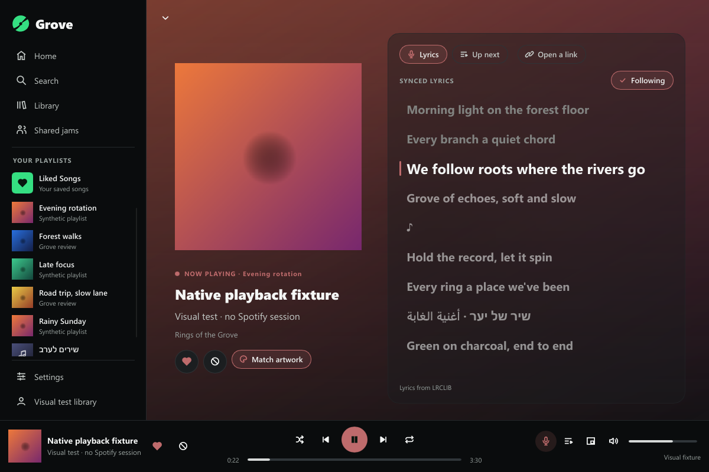
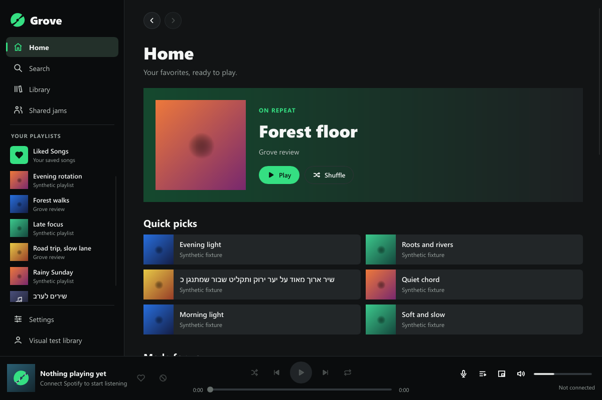

<p align="center"></p>

# Grove

**A lightweight, native Spotify player for Windows (with Linux and macOS previews) — the Spotify sibling of [Tide](https://github.com/yotam1001/tide-music).**

Grove is a Rust + [Slint](https://slint.dev/) desktop app. It browses your library through the Spotify Web API and plays audio in-process with [librespot](https://github.com/librespot-org/librespot), so there is no browser, Electron shell or external daemon. It shares Tide's playback, Windows-integration and jam crates so the two apps can host and join each other's listening rooms.

> **Status: early beta, not yet verified against live Spotify playback.** See [docs/BETA_STATUS.md](docs/grove/BETA_STATUS.md) and the [open issues](../../issues). Contributions welcome — the [`tide-parity`](../../labels/tide-parity) label tracks the gap to Tide.



## Features (today)

- **Browse:** card-based Home (hero, quick picks, Made for you, recent, top artists, playlists, albums), Search with an All view and tabs, Library tabs (Playlists, Albums, Artists, History) with a filter, collection and artist pages, Liked Songs and a Discovery mix
- **Listen:** native play/pause, seek, volume, shuffle and repeat; Now Playing with synced lyrics (LRCLIB) and an artwork-derived accent; a queue drawer with drag-to-reorder, autoplay and related songs
- **Audio:** 96/160/320 kbps, volume levelling, fade between songs, equalizer presets and a custom curve, sleep timer, resume positions, output-device choice and automatic reconnect after a network drop or sleep
- **Song menus:** Play next, Add to queue, Like/Unlike, View artist, Hide, and exact edits to playlists you own
- **Spotify request budgets:** a 429 cools down only its own endpoint group, shows the time left with Retry and tells `QUOTA_EXCEEDED` apart; Home, Library and the startup profile and playlists are cached per account, so a startup 429 never blocks playback
- **Shared jams:** encrypted nearby rooms, internet rooms through a free self-hostable relay, and joining **Tide** rooms (ISRC/duration matching)
- **Windows:** media controls, opt-in tray, global shortcuts, System theme, crash notices, in-app update check, per-user installer
- **Linux and macOS preview:** MPRIS / Now Playing, Secret Service / Keychain sign-in storage and mpv over a Unix socket; built, tested and packaged in CI but not yet run on real hardware
- Light/dark/System, Normal/Compact/Mini layouts, opt-in session history, local audio files through Tide's mpv backend (no Spotify login needed)
- PKCE sign-in in your browser; tokens live in the OS credential store and Grove never sees your password



Full feature/parity table: [docs/grove/TIDE_PARITY.md](docs/grove/TIDE_PARITY.md).

## Requirements

- Windows 10/11 x64 (Linux and macOS: preview builds from CI, see [docs/grove/PORTABLE.md](docs/grove/PORTABLE.md))
- Rust stable (see CI) — `cargo build --release -p grove-music`
- Spotify **Premium** for playback (browsing works on free accounts)
- `mpv` only for local-file playback

## Build and run

```powershell
cargo test --workspace
cargo run -p grove-music
# offline native UI checks (no Spotify access, no credentials)
./target/debug/grove-music.exe --smoke-ui "$env:TEMP/grove-smoke"
./target/debug/grove-music.exe --review-features "$env:TEMP/grove-features"
./target/debug/grove-music.exe --review-ui "$env:TEMP/grove-jams"
./target/debug/grove-music.exe --review-audio "$env:TEMP/grove-audio"
```

Then open **Account → Connect Spotify**, and **Enable playback** for the separate streaming approval. Details: [docs/grove/README.md](docs/grove/README.md).

## Repository layout

| Path | What |
| --- | --- |
| `crates/grove` | The Grove app (UI glue, Spotify auth, Web API, librespot engine, jams) |
| `crates/grove/src/app/` | Window wiring: callbacks, the event poll loop, the jam timer, smoke screenshots |
| `crates/grove/src/features/` | Feature controller, one file per area (search, collections, queue, jams…) |
| `ui/grove.slint` | Native interface entry: `GroveWindow`, sidebar and page switching |
| `ui/theme.slint`, `ui/components.slint`, `ui/model.slint`, `ui/player.slint` | Colour tokens, shared controls, row structs, player bar |
| `ui/pages/` | One file per page (home and search lists, library, queue, now playing, jams, settings, account, playlist editor) |
| `crates/jam` | Jam protocol, sync, encrypted nearby transport, Tide relay client and `grove-jam-relay` (interop-tested against Tide) |
| `crates/playback`, `crates/core`, `crates/windows` | Vendored from Tide: mpv backend (named pipe on Windows, Unix socket elsewhere), shared types, Windows media integration |
| `installer/`, `scripts/` | Per-user installer, packaging, release and shared-crate sync scripts |
| `docs/` | Design notes, beta status, parity audit, jam protocol |

The shared crates are a snapshot of Tide's: `crates/core` and `crates/windows` are pinned to a Tide commit and checked in CI by `scripts/sync_shared_crates.py` (see [docs/SHARED_CRATES.md](docs/SHARED_CRATES.md)).

## Relationship to Spotify

Grove is an unofficial client. librespot is unofficial and may need updates as Spotify changes. Spotify's terms apply to your account. Grove is not affiliated with or endorsed by Spotify.

## License

MIT — see [LICENSE](LICENSE) and [THIRD_PARTY_NOTICES.md](THIRD_PARTY_NOTICES.md).
